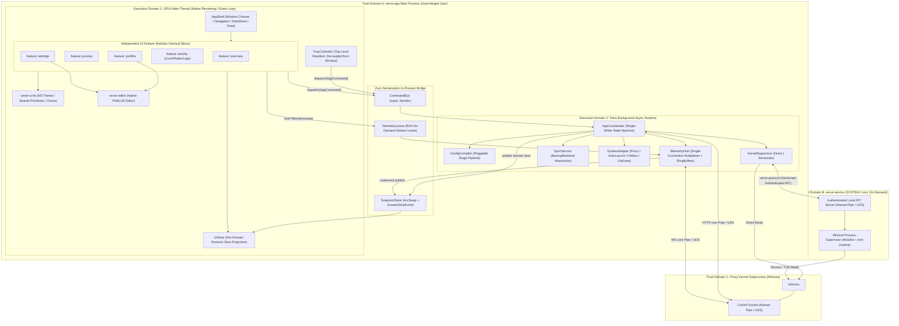
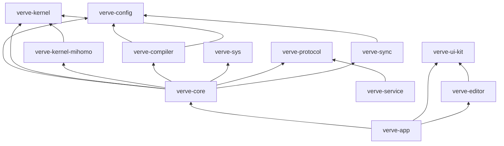
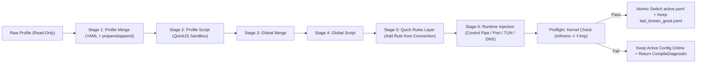
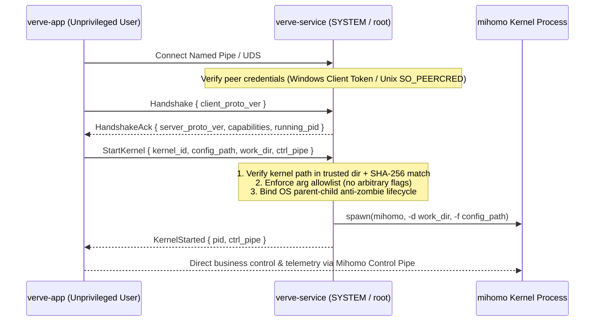

# System architecture

English | [中文](architecture.zh.md)

Verve is a cross-platform (Windows / macOS / Linux) native desktop proxy client built with **Rust** and **GPUI (`gpui-material`)**. It targets the **Mihomo** kernel first through decoupled domain abstractions and natively supports both declarative **YAML Merge** and sandboxed **JavaScript** configuration overrides.

This architecture eliminates legacy client baggage to prioritize **strong modularity, low coupling, independent rewritability, safe incremental updates, and clean extensibility**. Any individual UI view, kernel adapter, compiler stage, or sync backend can be replaced or evolved without cascading changes across the rest of the system.

<a id="core-architectural-principles"></a>

## 1. Core architectural principles

1. **Headless backend core**: All proxy orchestration, configuration compilation, telemetry aggregation, and OS integration live in UI-agnostic crates (`verve-core` and below). The UI layer is strictly a read-only projection and command dispatcher that can be rewritten partially or completely without disturbing backend logic.
2. **Feature-sliced UI**: No global god-view, god-state, or monolithic modal enum. Each functional view is an isolated feature module owning its local GPUI `Entity`, input states, scroll handles, and scoped side-sheet/confirmation overlays, subscribing only to the snapshot slice it renders.
3. **Compile-time unidirectional DAG**: Cargo Workspace boundaries enforce acyclic dependencies and prevent cross-layer leaks.
4. **Single-writer CQRS + sliced snapshot projection**: All state mutations serialize through `AppCoordinator`. Readers perform lock-free access on structurally shared snapshots partitioned by domain `Revision`, ensuring high-frequency telemetry never triggers unrelated view repaints.
5. **Explicit extension points**: Kernel protocols, configuration compiler stages, backup backends, and UI routes decouple through explicit traits or declarative registries (Open-Closed Principle).
6. **Window-decoupled residency & bounded resources**: Closing the main window releases all GPUI window and GPU resources immediately (natively replacing legacy "lightweight mode" hacks). Telemetry streams bind to RAII leases; logs, connections, and traffic series use fixed-capacity ring buffers.
7. **Least privilege & isolation**: The GUI runs as a standard unprivileged user. Privileged network operations (such as TUN) delegate kernel spawning over authenticated local IPC to a zero-business-logic supervisor (`verve-service`).

<a id="system-topology-and-trust-boundaries"></a>

## 2. System topology and trust boundaries

The system separates into **three process trust domains** and **two execution domains inside the main process**, communicating exclusively over strongly typed contracts:



<a id="workspace-module-layout-and-dependency-dag"></a>

## 3. Workspace module layout and dependency DAG

A multi-crate Cargo Workspace enforces a strict compile-time DAG and isolates backup/sync from core orchestration:



### Crate responsibilities and boundaries

| Crate | Kind | Core Responsibility | Dependency & Decoupling Boundary |
| --- | --- | --- | --- |
| `verve-protocol` | lib | Versioned IPC request/response frames and error codes between `verve-app` and `verve-service`. | Minimal dependencies (`serde` / `postcard` only); long-term backward compatibility. |
| `verve-config` | lib | Dual-domain configuration (`SyncableConfig` / `LocalMachineConfig`), schema versioning & migrations, SQLite WAL metadata (`state.db`), atomic persistence. | Zero dependency on kernel protocols, networking, or UI. |
| `verve-kernel` | lib | Proxy domain types (nodes, groups, providers, rules, connections, telemetry) and `ProxyKernel` / `KernelSupervisor` abstractions. | Contains no kernel-specific (e.g., Mihomo) wire schemas or transport details. |
| `verve-kernel-mihomo` | lib | Mihomo adapter: Pipe/UDS HTTP+WS client, preflight config check (`mihomo -t`), GeoData updates. | Sole module aware of Mihomo raw API schemas; exposes only `verve-kernel` types. |
| `verve-compiler` | lib | Immutable layered config compilation: pluggable `CompilerStage`, YAML Merge engine, `ScriptEngine` trait, and QuickJS sandbox. | Pure transformation and validation; no global state or network I/O. |
| `verve-sys` | lib | Cross-platform OS adapters: system proxy (pre-takeover snapshot & self-heal), auto-launch, tray backend, global hotkeys, power/network observers, single instance. | Normalizes platform differences into unified `OsEvent` and command handles. |
| `verve-sync` | lib | Backup and synchronization: `BackupBackend` trait, local encrypted archive (ZIP + Argon2 + AES-GCM), and WebDAV backend. | Operates solely on `verve-config` syncable domain; extensible to S3/Git/cloud backends. |
| `verve-core` | lib | Core orchestration: `AppCoordinator`, `TelemetryHub`, subscription fetch & scheduling, domain-sliced `AppSnapshot` publisher. | **Strictly forbids** any GPUI crate dependency; 100% headless-testable. |
| `verve-service` | bin | Minimal privileged daemon: peer credential auth, kernel path & SHA-256 allowlist verification, anti-zombie process supervision. | Depends only on `verve-protocol` and OS primitives; **forbids** config parsing, JS engines, or business logic. |
| `verve-ui-kit` | lib | Thin Material 3 design system layer over `gpui-material`: theme tokens, shared composites, virtual list helpers, Canvas traffic chart. | Shields views from upstream `gpui-material` churn; holds **no** domain state. |
| `verve-editor` | lib | Native code editor extracted cleanly from `gpui-base` primitives (Rope, Tree-sitter YAML/JS highlighting, find/replace, diagnostics, static completions) with M3 palette bridge. | Does not pull full `gpui-component`; connects directly to `verve-compiler` diagnostics. |
| `verve-app` | bin | Desktop composition root & feature-sliced UI: Tokio <-> GPUI bridge, window/tray lifecycle, `AppShell`, and `features/*`. | Feature modules **must not** import each other's internals; communicate strictly via `AppCommand` / `UiStore` / `ShellHandle`. |

<a id="feature-sliced-ui-architecture"></a>

## 4. Feature-sliced UI architecture (`verve-app`)

To prevent monolithic pages, god-state structs, and global modal enums, `verve-app` enforces a strict **Shell + Feature Slices** layout:

```text
crates/verve-app/src/
├── main.rs                  # Entrypoint: single-instance lock, tracing init, composition root
├── bootstrap.rs             # Tokio runtime + AppCoordinator + GPUI bridge wiring
├── bridge/
│   ├── store.rs             # UiStore: domain Arc<*Slice> + Revision subscriptions
│   ├── commands.rs          # Command dispatch helpers & async feedback (Toast / Error)
│   └── telemetry_lease.rs   # RAII TelemetryLease guard (auto-unsubscribe on Entity Drop)
├── shell/
│   ├── window.rs            # Root window view (TitleBar + NavRail/Drawer + Outlet)
│   ├── nav.rs               # Declarative RouteDescriptor registry
│   ├── sheet_host.rs        # Shared right-hand SideSheet & ConfirmDialog host
│   └── tray.rs              # Resident tray controller (survives window destruction)
└── features/                # Self-contained vertical slices with zero cross-imports
    ├── overview/            # Overview dashboard view entity + card submodules
    ├── proxies/             # Proxy groups + responsive node grid + Providers sheet
    ├── profiles/            # Subscription import bar + cards + editor/override sheet
    ├── activity/            # Unified troubleshooting center (Connections / Rules / Logs)
    │   ├── connections.rs   # Connection table + details & one-click Add Rule sheet
    │   ├── rules.rs         # Rule search + Rule Providers sheet
    │   └── logs.rs          # Live log stream + filter/pause/copy
    └── settings/            # Left-category / right-form Settings split by subdomain
        ├── network.rs       # System proxy / TUN / Service / mixed-port / LAN / IPv6
        ├── kernel.rs        # DNS / unified delay / global overrides / GeoData / ext ctrl
        ├── general.rs       # Theme / language / auto-launch / silent / tray / shell env
        └── maintenance.rs   # Backup & sync / dirs / diagnostics / updates / reset
```

### UI decoupling guardrails

1. **Sliced snapshot projection**: `AppSnapshot` splits into independent `Arc` subtrees with per-domain monotonic `Revision` counters:
   - `runtime: Arc<RuntimeSlice>` (proxy mode, system proxy/TUN status, kernel status, active profile summary)
   - `telemetry: Arc<TelemetrySlice>` (live up/down throughput, history ring buffer, memory usage)
   - `proxies: Arc<ProxiesSlice>` (proxy groups, node delays, Proxy Providers)
   - `profiles: Arc<ProfilesSlice>` (profiles list, refresh states, global override metadata)
   - `activity: Arc<ActivitySlice>` (filtered/sorted connection slice, rules, Rule Providers, log ring buffer)
   - `settings: Arc<SettingsSlice>` (`SyncableConfig` + `LocalMachineConfig` projection)

   High-frequency pushes (`telemetry`, `activity`) repaint only views subscribed to those slices.

2. **Private local state**: Every `TextFieldState`, dropdown, search query, expand/collapse map, editor state, and form draft lives privately inside its owning feature `Entity`, automatically cleaned up when unmounted.
3. **Hosted overlays (no `ActiveModal` enum)**: `AppShell` exposes two generic slots—`SideSheetHost` (details, forms, code editor) and `ConfirmDialogHost` (destructive confirmations). Features submit self-contained views via `ShellHandle::open_sheet(...)` without modifying any central enum.
4. **RAII `TelemetryLease`**: Mounting a live view acquires a lease for its stream (`Traffic`, `Connections`, `Logs`); unmounting or closing the main window drops the lease and immediately stops the background WebSocket stream when refcount reaches zero.

<a id="core-backend-subsystems"></a>

## 5. Core backend subsystems

### 5.1 Single-writer state & dual-domain persistence (`verve-core` & `verve-config`)

- **Single-writer CQRS (`AppCoordinator`)**: All writes from UI, tray, hotkeys, schedulers, and OS events enter a bounded `mpsc` queue as `AppCommand`. Config compilation, kernel reload, and network takeover execute serially; pure I/O tasks (subscription fetch, batch latency tests, WebDAV sync, GeoData downloads) spawn concurrently under `CancellationToken` and merge results back via internal events.
- **Dual-domain storage (`verve-config`)**:
  - **Syncable domain (`SyncableConfig`, `settings.toml`)**: Proxy policy, DNS override settings, subscription/override sources, appearance/language/hotkeys. Backups and WebDAV sync operate exclusively on this domain.
  - **Local machine domain (`LocalMachineConfig`, `local.toml`)**: Window geometry, local kernel path, service mode preference, TUN interface binding, auto-launch state.
  - **Runtime metadata (`state.db`, SQLite WAL)**: Subscription quota/expiry history, per-profile node selections, cached latency metadata.
  - All config files carry `schema_version` for deterministic forward migrations and write via same-directory `tempfile -> sync_all -> atomic rename`.

### 5.2 Pluggable immutable compiler pipeline (`verve-compiler`)

All subscription files are read-only inputs. Runtime configs synthesize through a pure, stage-composable `CompilerPipeline`:



- **Declarative Merge**: Deep mapping merge plus list primitives (`prepend-rules`, `append-rules`, `prepend-proxies`, `append-proxies`, `prepend-proxy-groups`, `append-proxy-groups`).
- **Quick Rules layer**: Rules created from the Connections view persist in a dedicated declarative layer rather than mutating raw subscription YAML, surviving subscription refreshes cleanly.
- **Sandboxed JS override (`ScriptEngine`)**: Compatible with `function main(config, profileName)`, executed via `rquickjs` inside `spawn_blocking` using a fresh short-lived `Runtime/Context` with strict memory limits, timeout interrupts, and zero filesystem/network capabilities.
- **Structured diagnostics**: Failures return `CompileDiagnostic { stage, line, col, message }` plus script console output for inline highlighting in `verve-editor`, while keeping the previous active configuration online.

### 5.3 Kernel transport & on-demand telemetry (`verve-kernel-mihomo` & `TelemetryHub`)

- **Local pipe control plane by default**: Communicates with Mihomo via `external-controller-pipe` (Windows Named Pipe) or `external-controller-unix` (Unix Domain Socket), eliminating local TCP port collisions and unauthenticated exposure. TCP listening is strictly opt-in with a high-entropy secret.
- **Unified `TelemetryHub`**: Maintains a single multiplexed connection set to the kernel, activates `Traffic`, `Memory`, `Connections`, and `Logs` streams strictly by `TelemetryLease` reference count, and performs throughput diffing, bounded ring buffering, filtering, and sorting off the UI thread.

### 5.4 Privileged supervisor & authenticated IPC (`verve-service` & `verve-protocol`)

`verve-service` is strictly a minimal, zero-business-logic process supervisor:



- **Channel authentication**: Strict SDDL on Windows Named Pipes; `0600` permissions + `SO_PEERCRED` / `LOCAL_PEERCRED` verification on Unix Domain Sockets.
- **Anti-zombie guarantees**: Windows Job Object (`JOB_OBJECT_LIMIT_KILL_ON_JOB_CLOSE`), Linux `PR_SET_PDEATHSIG` / pidfd, macOS process-group cleanup.
- **Linux daemonless option**: Detects and guides `setcap cap_net_admin,cap_net_bind_service+ep` for TUN without a background privileged service.
- **Stable minimal protocol**: Length-prefixed `postcard` frames limited to `Handshake`, `StartKernel`, `StopKernel`, `RestartKernel`, `QueryStatus`, and `ReadStderrTail`.

### 5.5 Network takeover, self-healing & OS integration (`verve-sys`)

- **Takeover state machine & crash recovery**: Persists original OS proxy settings before enabling system proxy or TUN and writes an active marker file; if a prior crash left stale loopback proxy settings, startup detects and restores them automatically.
- **Power & network topology listeners**: Cross-platform wake-from-sleep and interface-change observers (Windows `WM_POWERBROADCAST` + `NotifyIpInterfaceChange`, macOS `NSWorkspace` + `SCDynamicStore`, Linux `zbus` + Netlink) emit `OsEvent::{WakeUp, NetworkChanged}` to refresh kernel health and TUN/DNS state.
- **Window-decoupled tray**: `tray-icon` on Windows/macOS (main-thread `NSStatusItem` on macOS) and pure D-Bus `ksni` on Linux (zero GTK dependency).

<a id="core-extension-contracts"></a>

## 6. Core extension contracts

```rust
// crates/verve-kernel: kernel protocol abstraction (initial impl: verve-kernel-mihomo)
pub trait ProxyKernel: Send + Sync + 'static {
    fn capabilities(&self) -> KernelCapabilities;
    fn validate_config(&self, path: &Path) -> impl Future<Output = Result<(), Vec<ConfigDiagnostic>>> + Send;
    fn reload_config(&self, path: &Path) -> impl Future<Output = Result<(), KernelError>> + Send;
    fn fetch_proxies(&self) -> impl Future<Output = Result<ProxyTopology, KernelError>> + Send;
    fn select_proxy(&self, group: &str, name: &str) -> impl Future<Output = Result<(), KernelError>> + Send;
    fn test_delay(&self, name: &str, url: &str, timeout: Duration) -> impl Future<Output = Result<u16, KernelError>> + Send;
    fn fetch_rules(&self) -> impl Future<Output = Result<RuleSnapshot, KernelError>> + Send;
    fn update_provider(&self, kind: ProviderKind, name: &str) -> impl Future<Output = Result<(), KernelError>> + Send;
    fn close_connection(&self, id: Option<&str>) -> impl Future<Output = Result<(), KernelError>> + Send;
    fn open_telemetry(&self, kind: TelemetryKind) -> impl Future<Output = Result<TelemetryStream, KernelError>> + Send;
}

// crates/verve-kernel: static process supervision dispatch (zero vtable overhead)
pub enum KernelSupervisor {
    Direct(DirectProcessSupervisor),
    Service(DaemonIpcSupervisor),
}

// crates/verve-compiler: composable compilation stage
pub trait CompilerStage: Send + Sync {
    fn name(&self) -> &'static str;
    fn apply(&self, ctx: &CompileContext, doc: &mut serde_json::Value) -> Result<Vec<StageLog>, CompileDiagnostic>;
}

// crates/verve-compiler: sandboxed script override engine
pub trait ScriptEngine: Send + Sync + 'static {
    fn eval_override(
        &self,
        script: &str,
        config: serde_json::Value,
        profile_name: &str,
        limits: SandboxLimits,
    ) -> Result<ScriptOutput, CompileDiagnostic>;
}

// crates/verve-sync: pluggable backup/sync backend (Local Archive / WebDAV / future S3)
pub trait BackupBackend: Send + Sync + 'static {
    fn list_snapshots(&self) -> impl Future<Output = Result<Vec<BackupMeta>, SyncError>> + Send;
    fn push_snapshot(&self, archive: &[u8], meta: &BackupMeta) -> impl Future<Output = Result<(), SyncError>> + Send;
    fn pull_snapshot(&self, id: &str) -> impl Future<Output = Result<Vec<u8>, SyncError>> + Send;
    fn delete_snapshot(&self, id: &str) -> impl Future<Output = Result<(), SyncError>> + Send;
}
```

<a id="ecosystem-reuse"></a>

## 7. Open-source ecosystem reuse

| Capability Domain | Mature Crates Reused | Thin In-House Layer |
| --- | --- | --- |
| **UI & Material 3** | `gpui` + `gpui-base` + `gpui-material` | `verve-ui-kit` theme tokens, shared composites, Canvas traffic chart |
| **Native code editor** | Extracted `gpui-base` editor primitives + `ropey` + `tree-sitter` (YAML / JS) | `verve-editor`: M3 palette bridge, Mihomo completions, inline compiler diagnostics |
| **Async & sliced sharing** | `tokio` + `tokio-util` (`CancellationToken`) + `async-channel` + `arc-swap` | Per-domain `Revision` projection & RAII `TelemetryLease` |
| **Local IPC & kernel pipe** | `interprocess` + `hyper` + `hyper-util` + `tokio-tungstenite` + `postcard` | Peer credential auth, IPC framing, Pipe/UDS transport adapter |
| **Privileged service** | `service-manager` + `windows-service` | Minimal `verve-service` supervision loop, allowlist & anti-zombie guards |
| **System proxy & OS** | `sysproxy`, `tray-icon` / `ksni`, `auto-launch`, `global-hotkey`, `single-instance`, `notify-debouncer-mini` | Takeover snapshot/self-heal, unified `TrayAdapter`, normalized `OsEvent` |
| **Config & storage** | `serde_yaml_ng` + `toml` + `rusqlite` (bundled WAL) + `tempfile` + `directories` | Dual-domain schema, version migrations, atomic writes |
| **JS override sandbox** | `rquickjs` (QuickJS-NG) | `ScriptEngine` memory/timeout sandbox & console capture |
| **Fetch & encrypted sync** | `reqwest` + `opendal` (`services-webdav`) + `argon2` + `aes-gcm` + `zip` | `BackupBackend` implementations & encrypted syncable archive |
| **Observability & i18n** | `tracing` + `tracing-subscriber` + `tracing-appender` + `rust-i18n` | Sanitized diagnostics export & log rotation/cleanup |
