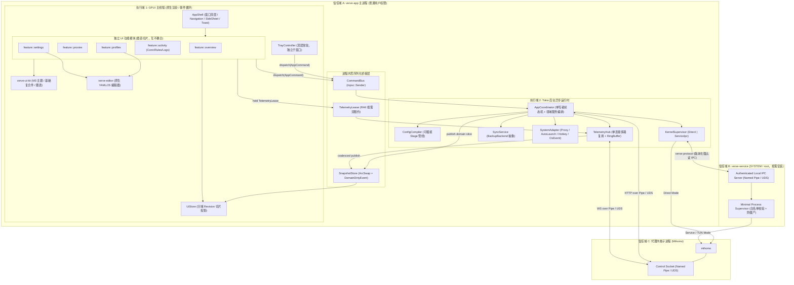
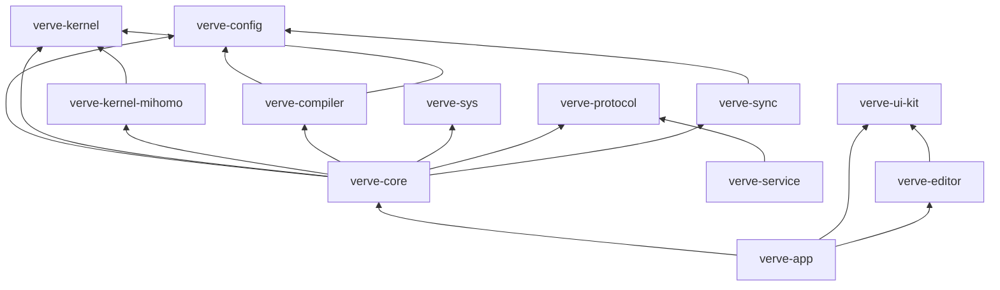
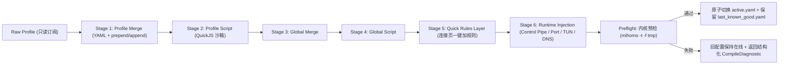
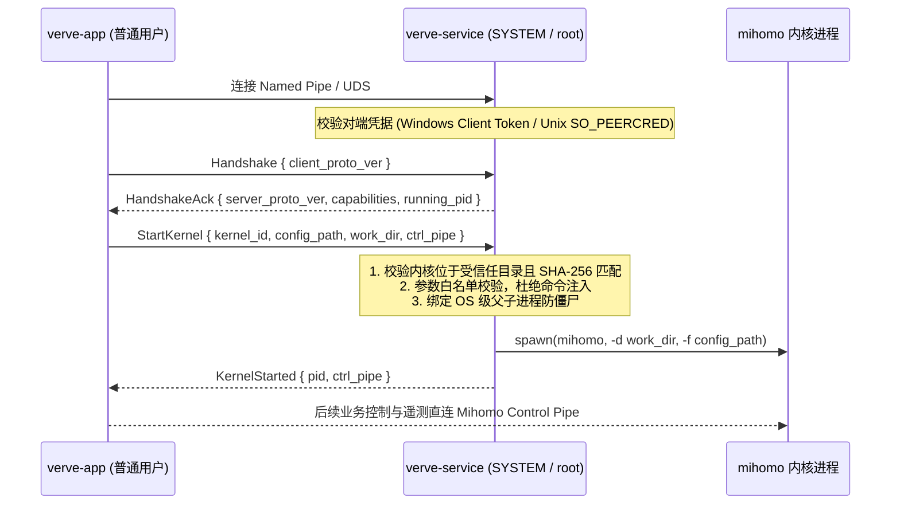

# 系统架构设计

[English](architecture.md) | 中文

Verve 是一款基于 **Rust** 与 **GPUI (`gpui-material`)** 构建的跨平台（Windows / macOS / Linux）原生桌面代理客户端。首期聚焦 **Mihomo** 内核，原生支持 **声明式 Merge** 与 **JavaScript 脚本** 双配置覆写体系。

本架构在剔除旧版客户端历史包袱后重构，核心目标为：**强模块化、低耦合、可独立重写、易于增量更新与按需扩展**。任何单个页面、内核适配器、编译阶段或同步后端都可以在不影响其余子系统的前提下独立替换或演进。

<a id="core-architectural-principles"></a>

## 1. 核心架构原则

1. **后端无头化（Headless Core）**：全部代理业务、配置编译、遥测聚合与系统集成均沉淀在无 UI 依赖的底层 Crate 中；UI 层仅是状态的只读投影与命令派发器，可随时局部重写甚至整体替换。
2. **UI 垂直功能切片（Feature-Sliced UI）**：严禁全局“上帝视图 / 上帝状态 / 全局弹窗大枚举”。每个业务页面作为独立功能模块封装，自持局部 `Entity`、表单输入状态、滚动句柄与作用域内抽屉/确认框，仅订阅自身所需的不可变快照切片。
3. **编译期单向依赖 DAG**：通过 Cargo Workspace 严格约束依赖方向，阻断循环依赖与跨层状态泄漏。
4. **单写者 CQRS + 切片投影**：所有状态变更经由 `AppCoordinator` 串行提交，读路径无锁访问结构化共享快照；每个状态域拥有独立版本号（`Revision`），仅变更域触发对应 UI 切片重绘。
5. **显式扩展点（Extension Points）**：内核协议、配置编译管线、备份后端、页面路由均通过 Trait 或声明式注册表解耦，新增能力遵循开闭原则（OCP）。
6. **原生常驻与资源有界**：窗口与后台核心解耦，关闭主窗口即释放全部 GPUI 渲染资源（天然替代“轻量模式”）；遥测流采用 RAII 租约自动回收，日志/连接/流量历史严格使用固定容量环形缓冲区。
7. **最小权限与安全隔离**：GUI 主进程始终运行在普通用户权限下；仅特权网络能力（如 TUN）经强认证本地 IPC 委托零业务逻辑的极简守护进程拉起经校验的内核。

<a id="system-topology-and-trust-boundaries"></a>

## 2. 系统拓扑与信任边界

系统划分为 **三个进程信任域** 与 **两个主进程内执行域**，跨边界通信全部收敛为强类型契约：



<a id="workspace-module-layout-and-dependency-dag"></a>

## 3. Workspace 模块划分与依赖拓扑

通过多 Crate Workspace 在编译期强制单向 DAG，并将**备份同步**与**核心调度**解耦，避免单点膨胀：



### 各 Crate 职责与边界红线

| Crate | 类型 | 核心职责 | 依赖约束与解耦红线 |
| :--- | :--- | :--- | :--- |
| `verve-protocol` | lib | `verve-app` 与 `verve-service` 间版本化 IPC 帧定义与错误码 | 零重依赖（仅 `serde` / `postcard`）；长期保持向后兼容 |
| `verve-config` | lib | 双域配置模型（`SyncableConfig` / `LocalMachineConfig`）、Schema 版本迁移、SQLite 元数据（`state.db`）、原子落盘 | 不依赖内核协议、网络或 UI；负责配置兼容性演进 |
| `verve-kernel` | lib | 代理领域模型（节点、分组、提供者、规则、连接、遥测）与 `ProxyKernel` / `KernelSupervisor` 抽象 | 不含任何具体内核（如 Mihomo）原始字段或传输细节 |
| `verve-kernel-mihomo` | lib | Mihomo 适配器：Pipe/UDS HTTP+WS 客户端、配置预检（`mihomo -t`）、GeoData 更新 | 唯一知晓 Mihomo API Schema 的模块，对外仅输出 `verve-kernel` 领域类型 |
| `verve-compiler` | lib | 不可变分层配置编译管线：可插拔 `CompilerStage`、YAML Merge 引擎、`ScriptEngine` Trait 与 QuickJS 沙箱 | 纯函数式转换与校验，无全局状态、无网络 I/O |
| `verve-sys` | lib | 三端 OS 原生能力封装：系统代理（含接管前快照与自愈）、开机自启、托盘底层、全局热键、电源/网卡监听、单实例 | 屏蔽平台差异，向上输出统一 `OsEvent` 与命令句柄 |
| `verve-sync` | lib | 备份与同步子系统：`BackupBackend` 抽象、本地加密归档（ZIP + Argon2 + AES-GCM）与 WebDAV 实现 | 仅操作 `verve-config` 同步域，可独立替换或扩展 S3/Git/云盘后端 |
| `verve-core` | lib | 业务核心编排：`AppCoordinator`、`TelemetryHub`、订阅拉取/定时更新、按域拆分的 `AppSnapshot` 发布 | **严禁依赖任何 GPUI Crate**；支持 100% headless 集成测试 |
| `verve-service` | bin | 极简特权守护进程：对端凭据鉴权、内核二进制路径与哈希白名单校验、进程托管与防僵尸 | 仅依赖 `verve-protocol` 与 OS 原语；**严禁引入**配置解析、JS 引擎或业务逻辑 |
| `verve-ui-kit` | lib | 基于 `gpui-material` 的设计系统薄层：M3 主题 Token 导出、语义组件、虚拟列表、Canvas 流量图表 | 隔离上游 `gpui-material` API 演进；**不含任何业务状态或领域逻辑** |
| `verve-editor` | lib | 独立抽取的原生代码编辑器（Rope + Tree-sitter YAML/JS 高亮 + 查找替换 + 诊断/静态补全）与 M3 配色桥接 | 不引入完整 `gpui-component`；通过门面 API 对接 `verve-compiler` 诊断 |
| `verve-app` | bin | 桌面组合根与垂直切片 UI：Tokio <-> GPUI 桥接、窗口/托盘生命周期、`AppShell` 与独立 `features/*` 模块 | 各 `feature` 模块**禁止互相直接 import 内部实现**，统一经由 `AppCommand` / `UiStore` / `ShellHandle` 通信 |

<a id="feature-sliced-ui-architecture"></a>

## 4. UI 层模块化与解耦架构（`verve-app`）

为彻底避免单体巨型页面、全局弹窗枚举与跨页状态缠绕，`verve-app` 采用 **Shell + 垂直功能切片（Feature Modules）** 架构：

```text
crates/verve-app/src/
├── main.rs                  # 入口：单实例检查、日志初始化、组合根装配
├── bootstrap.rs             # Tokio 运行时 + AppCoordinator + GPUI 桥接装配
├── bridge/
│   ├── store.rs             # UiStore：按域持有 Arc<*Slice> 与 Revision 订阅
│   ├── commands.rs          # 命令派发辅助与异步结果回流（Toast / Error 映射）
│   └── telemetry_lease.rs   # RAII TelemetryLease 封装（Entity Drop 自动退订）
├── shell/
│   ├── window.rs            # 主窗口根视图（TitleBar + NavRail/Drawer + Outlet）
│   ├── nav.rs               # 声明式 RouteDescriptor 注册表
│   ├── sheet_host.rs        # 统一右侧抽屉 (SideSheet) 与确认弹窗宿主
│   └── tray.rs              # 常驻托盘控制器（独立于主窗口存活）
└── features/                # 各功能域完全自治，互不依赖
    ├── overview/            # 概览页（View Entity + 局部状态 + 卡片子模块）
    ├── proxies/             # 代理页（分组列表 + 响应式节点网格 + Provider 抽屉）
    ├── profiles/            # 配置页（导入栏 + 卡片列表 + 编辑器/覆写抽屉）
    ├── activity/            # 活动排障中心（Tab: connections / rules / logs）
    │   ├── connections.rs   # 连接表 + 右键一键加规则抽屉
    │   ├── rules.rs         # 规则搜索 + Rule Providers 面板
    │   └── logs.rs          # 日志流 + 过滤/暂停/复制
    └── settings/            # 设置页（左分类 + 右表单，按子域拆分为独立小文件）
        ├── network.rs       # 系统代理 / TUN / 服务模式 / 端口 / LAN / IPv6
        ├── kernel.rs        # DNS / 统一延迟 / 全局覆写 / GeoData / 外部控制
        ├── general.rs       # 主题 / 语言 / 自启 / 静默 / 托盘 / 终端环境变量
        └── maintenance.rs   # 备份同步 / 目录 / 诊断 / 更新 / 重置
```

### UI 解耦约束（工程红线）

1. **分域只读快照（Sliced Snapshot Projection）**：`AppSnapshot` 内部按业务域拆分为独立 `Arc` 子树，并附带单调递增的 `Revision`：
   - `runtime: Arc<RuntimeSlice>`（代理模式、系统代理/TUN 开关、内核状态、当前激活配置摘要）
   - `telemetry: Arc<TelemetrySlice>`（实时上下行速率、历史环形缓冲、内存占用）
   - `proxies: Arc<ProxiesSlice>`（代理组、节点延迟、Proxy Providers）
   - `profiles: Arc<ProfilesSlice>`（配置列表、更新状态、全局覆写元信息）
   - `activity: Arc<ActivitySlice>`（连接视图切片、规则列表、Rule Providers、日志环形缓冲）
   - `settings: Arc<SettingsSlice>`（`SyncableConfig` + `LocalMachineConfig` 投影）

   高频遥测（每秒推送的 `telemetry` / `activity`）**仅刷新订阅了对应切片的视图 Entity**，不会引发 `proxies`、`profiles` 或 `settings` 的无效重绘。

2. **局部状态私有化**：输入框（`TextFieldState`）、下拉框、搜索过滤词、展开折叠状态、代码编辑器实例、局部草稿全部归属对应 `Feature` 自己的 GPUI `Entity`，页面切换销毁或重建时自动清理。
3. **交互宿主化（消灭全局 `ActiveModal`）**：`Shell` 仅提供 `SideSheetHost`（详情查看、表单配置、代码编辑）与 `ConfirmDialogHost`（破坏性操作二次确认）。各功能模块通过 `ShellHandle::open_sheet(...)` 提交自包含视图 Entity，增删子面板无需改动全局枚举。
4. **按需遥测租约（RAII `TelemetryLease`）**：页面挂载时申请通道租约，离开页面或关闭主窗口时 `Entity` 销毁、`TelemetryLease` 自动 `Drop`，引用计数归零后后台立即断开对应 WebSocket 流。

<a id="core-backend-subsystems"></a>

## 5. 核心后端子系统架构

### 5.1 状态管理、并发与双域持久化 (`verve-core` & `verve-config`)

- **单写者 CQRS (`AppCoordinator`)**：所有来自 UI、托盘、全局热键、定时任务与 OS 事件的写请求均封装为 `AppCommand` 投递至有界 `mpsc` 通道；配置编译、内核重载、网络接管严格串行执行；耗时纯 I/O 任务（订阅下载、节点批量测速、WebDAV 传输、GeoData 更新）在 `CancellationToken` 约束下并发派生，结果通过内部事件回流合并。
- **双域配置隔离与版本迁移 (`verve-config`)**：
  - **可同步域 (`SyncableConfig`, `settings.toml`)**：代理策略、DNS 覆写策略、订阅与覆写源文件、外观/语言/热键偏好。备份与 WebDAV 仅同步此域，杜绝跨操作系统本机配置污染。
  - **本机环境域 (`LocalMachineConfig`, `local.toml`)**：窗口几何、本机内核路径、服务模式状态、TUN 网卡偏好、开机自启开关。
  - **运行元数据 (`state.db`, SQLite WAL)**：订阅流量与到期记录、各配置的节点选择记忆、延迟缓存。
  - 所有配置文件均含 `schema_version` 支持向前确定性迁移，落盘统一采用同目录 `tempfile -> sync_all -> atomic rename`。

### 5.2 可插拔不可变配置编译管线 (`verve-compiler`)

所有订阅源文件均视为**只读输入**，运行时配置由纯函数式 `CompilerPipeline` 按序合成，每一阶段均可独立测试、启停与扩展：



- **声明式 Merge**：支持深度映射合并与列表扩展原语（`prepend-rules` / `append-rules` / `prepend-proxies` / `append-proxies` / `prepend-proxy-groups` / `append-proxy-groups`）。
- **连接页一键加规则层（Quick Rules Layer）**：不手工改写原始订阅 YAML，而是作为独立声明式规则片自动注入编译管线，订阅刷新后依然持久生效。
- **沙箱化 JS 覆写 (`ScriptEngine`)**：兼容 `function main(config, profileName)`；基于 `rquickjs` 在 `spawn_blocking` 中以短生命周期 `Runtime/Context` 执行，强制内存上限与超时中断钩子，无文件/网络权限，执行完毕立即释放内存。
- **可诊断闭环**：任一阶段出错均返回结构化 `CompileDiagnostic { stage, line, col, message }` 与脚本控制台输出，直接投射至 `verve-editor` 行内高亮；内核维持旧配置在线不断网。

### 5.3 内核适配与按需遥测 (`verve-kernel-mihomo` & `TelemetryHub`)

- **默认本地管道控制面**：优先使用 Mihomo `external-controller-pipe`（Windows Named Pipe）或 `external-controller-unix`（Unix Domain Socket）进行 REST 与 WebSocket 通信，避免本地端口冲突与未授权访问；仅在用户显式启用外部控制时监听 TCP 并强制高熵 Secret。
- **单一遥测中枢 (`TelemetryHub`)**：全局仅维持一套内核流连接，按 `TelemetryLease` 引用计数按需启停 `Traffic`、`Memory`、`Connections`、`Logs` 四类流；后台完成速率差分、固定容量 `VecDeque` 环形缓冲管理、过滤与排序，UI 线程零重计算。

### 5.4 特权守护进程与安全 IPC (`verve-service` & `verve-protocol`)

特权服务保持**零业务逻辑、极简长期稳定**：



- **通道鉴权**：Windows Named Pipe 配置严格 SDDL，Unix Domain Socket 限制权限 `0600` + `SO_PEERCRED`/`LOCAL_PEERCRED`。
- **防僵尸保障**：Windows 绑定 `JOB_OBJECT_LIMIT_KILL_ON_JOB_CLOSE`，Linux 使用 `PR_SET_PDEATHSIG` / pidfd，macOS 进程组回收；启动时清理遗留状态。
- **Linux 免常驻路径**：除 `systemd` 服务外，支持检测与引导配置 `cap_net_admin,cap_net_bind_service+ep`（`setcap`），无需常驻守护进程即可启用 TUN。
- **协议稳定**：`verve-protocol` 仅保留 `Handshake` / `StartKernel` / `StopKernel` / `RestartKernel` / `QueryStatus` / `ReadStderrTail` 六类原语，主程序常规升级无需重装服务。

### 5.5 网络接管、自愈与系统集成 (`verve-sys`)

- **代理接管状态机与异常自愈**：开启系统代理或 TUN 前持久化原始系统代理快照；写入运行标记文件，若检测到上次异常崩溃残留本地代理指向，下次启动自动校验并恢复。
- **电源与网络拓扑监听**：跨平台监听休眠唤醒与物理网卡切换（Windows `WM_POWERBROADCAST` + `NotifyIpInterfaceChange`、macOS `NSWorkspace` + `SCDynamicStore`、Linux `zbus` + Netlink），发射 `OsEvent::{WakeUp, NetworkChanged}` 触发内核健康检查与 TUN/DNS 刷新。
- **托盘常驻与窗口解耦**：Windows/macOS 使用 `tray-icon`（macOS 严格在主线程操作），Linux 使用纯 D-Bus `ksni`（零 GTK 依赖）；关闭主窗口仅销毁 GPUI 窗口释放渲染资源，托盘点击瞬间重建窗口并直接挂载当前 `AppSnapshot`。

<a id="core-extension-contracts"></a>

## 6. 核心扩展契约

```rust
// crates/verve-kernel: 内核协议抽象（首期实现: verve-kernel-mihomo；未来可扩展 sing-box 等）
pub trait ProxyKernel: Send + Sync + 'static {
    fn capabilities(&self) -> KernelCapabilities;
    fn validate_config(&self, path: &Path) -> impl Future<Output = Result<(), Vec<ConfigDiagnostic>>> + Send;
    fn reload_config(&self, path: &Path) -> impl Future<Output = Result<(), KernelError>> + Send;
    fn fetch_proxies(&self) -> impl Future<Output = Result<ProxyTopology, KernelError>> + Send;
    fn select_proxy(&self, group: &str, name: &str) -> impl Future<Output = Result<(), KernelError>> + Send;
    fn test_delay(&self, name: &str, url: &str, timeout: Duration) -> impl Future<Output = Result<u16, KernelError>> + Send;
    fn fetch_rules(&self) -> impl Future<Output = Result<RuleSnapshot, KernelError>> + Send;
    fn update_provider(&self, kind: ProviderKind, name: &str) -> impl Future<Output = Result<(), KernelError>> + Send;
    fn close_connection(&self, id: Option<&str>) -> impl Future<Output = Result<(), KernelError>> + Send;
    fn open_telemetry(&self, kind: TelemetryKind) -> impl Future<Output = Result<TelemetryStream, KernelError>> + Send;
}

// crates/verve-kernel: 进程托管策略（封闭枚举静态分发，零虚表）
pub enum KernelSupervisor {
    Direct(DirectProcessSupervisor),
    Service(DaemonIpcSupervisor),
}

// crates/verve-compiler: 可插拔编译阶段抽象
pub trait CompilerStage: Send + Sync {
    fn name(&self) -> &'static str;
    fn apply(&self, ctx: &CompileContext, doc: &mut serde_json::Value) -> Result<Vec<StageLog>, CompileDiagnostic>;
}

// crates/verve-compiler: 脚本覆写引擎抽象（默认: 短生命周期 QuickJS 沙箱）
pub trait ScriptEngine: Send + Sync + 'static {
    fn eval_override(
        &self,
        script: &str,
        config: serde_json::Value,
        profile_name: &str,
        limits: SandboxLimits,
    ) -> Result<ScriptOutput, CompileDiagnostic>;
}

// crates/verve-sync: 可扩展备份后端抽象（本地加密归档 / WebDAV / 未来 S3 等）
pub trait BackupBackend: Send + Sync + 'static {
    fn list_snapshots(&self) -> impl Future<Output = Result<Vec<BackupMeta>, SyncError>> + Send;
    fn push_snapshot(&self, archive: &[u8], meta: &BackupMeta) -> impl Future<Output = Result<(), SyncError>> + Send;
    fn pull_snapshot(&self, id: &str) -> impl Future<Output = Result<Vec<u8>, SyncError>> + Send;
    fn delete_snapshot(&self, id: &str) -> impl Future<Output = Result<(), SyncError>> + Send;
}
```

<a id="ecosystem-reuse"></a>

## 7. 开源生态复用策略

| 能力域 | 复用的成熟开源 Crate | 项目自研薄层 |
| :--- | :--- | :--- |
| **UI 与 Material 3 体系** | `gpui` + `gpui-base` + `gpui-material` | `verve-ui-kit` 主题 Token、少量业务复合件与 Canvas 流量图 |
| **原生代码编辑器** | 抽取 `gpui-component` 基于 `gpui-base` 的 `Editor` 核心 + `ropey` + `tree-sitter`（YAML / JS） | `verve-editor`：M3 配色桥接、Mihomo 静态补全与编译诊断渲染 |
| **异步并发与切片共享** | `tokio` + `tokio-util` (`CancellationToken`) + `async-channel` + `arc-swap` | 分域 `Revision` 切片投影与 `TelemetryLease` RAII 租约 |
| **本地 IPC 与管道通信** | `interprocess` + `hyper` + `hyper-util` + `tokio-tungstenite` + `postcard` | 对端凭据鉴权、IPC 帧封装与 Named Pipe / UDS 传输适配 |
| **特权服务管理** | `service-manager` + `windows-service` | 极简 `verve-service` 白名单校验与防僵尸托管循环 |
| **系统代理与 OS 集成** | `sysproxy`、`tray-icon` / `ksni`、`auto-launch`、`global-hotkey`、`single-instance`、`notify-debouncer-mini` | 代理接管快照与异常自愈、跨平台 `TrayAdapter`、`OsEvent` 归一化 |
| **配置与持久化** | `serde_yaml_ng` + `toml` + `rusqlite` (bundled WAL) + `tempfile` + `directories` | 双域配置 Schema、版本迁移与原子落盘 |
| **JS 覆写沙箱** | `rquickjs` (QuickJS-NG) | `ScriptEngine` 内存/超时沙箱隔离与日志捕获 |
| **订阅拉取与加密同步** | `reqwest` + `opendal` (`services-webdav`) + `argon2` + `aes-gcm` + `zip` | `BackupBackend` 实现与同步域加密归档 |
| **观测与多语言** | `tracing` + `tracing-subscriber` + `tracing-appender` + `rust-i18n` | 结构化诊断包导出与自动日志轮转清理 |
