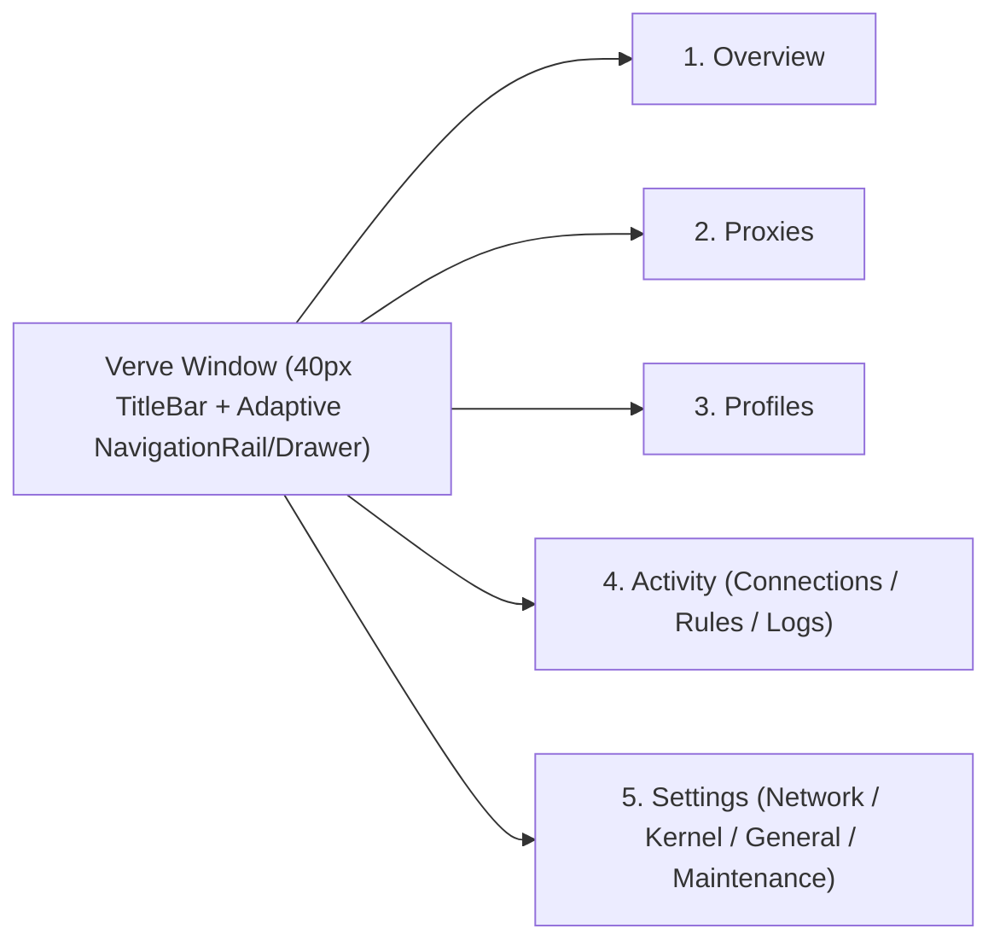

# Product design and feature audit

English | [中文](design.zh.md)

This specification serves two purposes:

1. **Complete feature audit** of the earlier Clash Verge Rev–style prototype (8 pages, 35+ modals, ~100 settings), classifying every capability into **P0 core**, **P1 daily high-value**, **P2 optional power-user**, or **Drop legacy baggage**.
2. **Ground-up native design** for Verve built directly around GPUI + `gpui-material` (Material 3 Expressive) and delivered strictly by semantic version milestones in [Versioning and releases](release.md#versioned-roadmap).

## Part 1: Complete feature audit and triage

Priority tiers:

- **P0 (Core must-have, targeted for `0.0.3`)**: Minimum end-to-end daily proxy client loop.
- **P1 (Daily high-value, targeted for `0.0.4` – `0.0.5`)**: High-frequency workflows completing the everyday experience.
- **P2 (Optional power-user, targeted for `0.0.6`)**: Useful advanced capabilities kept out of the primary visual path.
- **Drop (Legacy baggage)**: Inherited Web-client sprawl, high-maintenance/low-value scrapers, or patterns conflicting with native GPUI architecture—**explicitly excluded**.

### 1. Global shell and OS integration

| Audited Feature | Tier | Rationale & Handling |
| --- | :---: | --- |
| Title bar & collapsible sidebar navigation | **P0** | Adaptive `NavigationDrawer` / `NavigationRail`. |
| Sidebar live telemetry pod (throughput + mini sparkline + RAM) | **P1** | Compact footer card; drop click-to-toggle filled/outline style gimmick. |
| Light / Dark / System appearance & dynamic accent color | **P0** | Driven by `gpui-material` seed schemes. |
| Resident system tray & release GPU resources on window close | **P0** | Closing main window destroys the GPUI window; tray menu exposes Mode / SysProxy / TUN / Quit. |
| Single instance, auto-launch, silent start | **P1** | Built into `verve-sys` and General settings. |
| Bilingual UI (`zh-CN` / `en-US`) | **P1** | Managed via `rust-i18n`; no inline `if zh {} else {}` branching. |
| Global hotkeys (System Proxy / TUN / Mode / Toggle Window) | **P2** | Restricted to 4–5 core actions; drop obscure actions like reactivate profile. |
| Exit confirmation dialog | **P2** | Optional on tray quit; window close defaults to minimize-to-tray. |
| Sidebar icon modes (monochrome / colorful / hidden) | **Drop** | Breaks M3 visual hierarchy; use consistent M3 icon styling. |
| 4-corner snackbar notification placement | **Drop** | Fixed bottom-right Snackbar. |
| Lightweight mode toggle + idle timer + confirm modal | **Drop** | **Legacy WebView workaround**; native GPUI window teardown frees rendering resources automatically. |
| Global settings full-text search modal (`SettingsSearch`) | **Drop** | Streamlined 4-category settings require no dedicated search index. |
| Custom 3-state tray icon image uploader / inline tray proxy group mode | **Drop** | Ship crisp built-in 3-state tray icons (Idle / SysProxy / TUN). |
| Force native system titlebar toggle | **Drop** | Follow each OS's best-practice chrome automatically. |
| Hover-jump navigator delay tuning | **Drop** | Micro-configuration noise. |

### 2. Overview (formerly `Home`)

| Audited Feature | Tier | Rationale & Handling |
| --- | :---: | --- |
| Proxy mode selector (`Rule` / `Global` / `Direct`) | **P0** | Primary control card on Overview. |
| System Proxy & TUN toggles + service status indicator | **P0** | Unified "Network Takeover" card showing active mode clearly. |
| Active profile summary (name, quota, expiry, refresh, quick switch) | **P0** | Inline dropdown switcher; removes separate "Switch Profile" modal. |
| Primary proxy group & active exit node quick switch | **P0** | One-click node switch and test directly from Overview. |
| Live traffic chart & session upload/download/RAM metrics | **P1** | Single clean chart card (`1m` / `5m` window). |
| One-click copy shell proxy env (`PowerShell` / `Bash` / `Zsh` / `Fish` / `CMD`) | **P1** | High-frequency developer utility placed directly in quick actions. |
| Exit public IP & geolocation lookup (manual on-demand) | **P2** | Manual trigger only; drop background polling and raw lat/lon fields. |
| 9-card customizable visibility modal (`HomeSettings`) | **Drop** | Fixed, high-signal layout removes dashboard builder bloat. |
| Website latency test card (CRUD + reorder + custom SVG modal) | **Drop** | Redundant with proxy delay testing and high UI complexity. |
| Separate Clash Info card + System Info card | **Drop** | Condensed into a single compact footer status strip (kernel version / uptime). |
| Static manual/help modal (`ManualInfo`) | **Drop** | Replaced by concise inline hints and documentation links. |

### 3. Proxies

| Audited Feature | Tier | Rationale & Handling |
| --- | :---: | --- |
| Mode switch bar (`Rule` / `Global` / `Direct`) | **P0** | Synced with Overview; clear empty view in `Direct` mode. |
| Collapsible proxy groups (`Selector` / `URLTest` / `Fallback`) & node selection | **P0** | Responsive auto-column node card grid (no manual 1–5 column setting). |
| Single-node & group delay testing with color-coded badges | **P0** | Supports unified delay and custom test URL. |
| Inline group tools: filter, sort (Default / Delay / Name), locate active node | **P1** | Clean single toolbar; default case-insensitive fuzzy search (drop `Aa`/`ab`/`.*` pills). |
| Node protocol & UDP badges | **P1** | Show core protocol + UDP badge; drop XUDP/TFO/MPTCP/SMUX visual noise. |
| Proxy Providers inspection, health check & refresh | **P1** | Hosted in a slide-over drawer rather than stacked modals. |
| Clear fixed node on auto-select groups | **P2** | Compact action in group header menu. |
| Visual proxy chaining mode (`Chain Mode` + confirm/warning modals) | **Drop** | Niche high-complexity UI; advanced users declare `dialer-proxy` in Merge/Script. |
| Left/right toolbar placement toggle, group icon toggle, right-side jump rail | **Drop** | Excessive layout customization; keep one clean responsive layout. |

### 4. Profiles

| Audited Feature | Tier | Rationale & Handling |
| --- | :---: | --- |
| Top URL bar one-click remote subscription import | **P0** | Paste URL to import; parses subscription quota/expiry headers automatically. |
| Create local profile / import local YAML file | **P0** | Unified "New / Import" side sheet. |
| Profile cards: activate, quota progress, expiry, updated time, refresh, delete | **P0** | Clear active indication and lightweight delete confirmation. |
| Update all subscriptions & scheduled auto-update interval | **P1** | Background scheduler; failed updates preserve active config with clear diagnostics. |
| Edit profile metadata (name, URL, interval, proxy-update toggle, UA/timeout) | **P1** | Side sheet with common fields visible and advanced HTTP options collapsed. |
| Native code editing (Raw YAML / Profile Merge & Script / Global Merge & Script) | **P1** | Powered by `verve-editor` (YAML/JS highlighting, Mihomo completions, inline preflight diagnostics). |
| Read-only runtime config (`active.yaml`) preview & open in external editor | **P1** | Essential for inspecting merged output. |
| Script console log viewer | **P1** | Embedded bottom panel inside the script editor sheet—no separate global modal. |
| Copy subscription URL & reorder profiles | **P2** | Lightweight card overflow actions. |
| Visual Rules / Proxies / Proxy Groups form editors (3 massive AST builders) | **Drop** | **Major legacy bloat**; replaced cleanly by `verve-editor`, Merge/Script, and Connections' one-click Add Rule. |
| Batch multi-select & batch delete modal | **Drop** | Personal setups typically hold 1–5 profiles; single-card delete suffices. |
| Subscription QR code share modal (`ProfileQr`) | **Drop** | Low desktop utility and risks leaking credentialed subscription URLs. |

### 5. Connections

| Audited Feature | Tier | Rationale & Handling |
| --- | :---: | --- |
| Live active connections table (host, chains, rule, process, speed, traffic, age) | **P1** | Single virtualized compact table (drop dual list/table views). |
| Keyword search, protocol filter (`All` / `TCP` / `UDP`), column header sorting | **P1** | Computed off-thread in `TelemetryHub`. |
| Pause/resume snapshot, close single connection, close all connections | **P1** | Essential after node switches or inspecting long-lived sockets. |
| Connection detail side sheet (full chain, src/dst, process path, sniff host) | **P1** | Slide-over drawer keeping table context visible. |
| Right-click "Add Rule from Connection" (domain / process / IP → policy) | **P1** | Writes into `verve-compiler`'s Quick Rules stage so rules survive subscription updates. |
| Closed connections history tab | **P2** | Fixed 200-item ring buffer for short-lived requests. |
| 12-column drag-width / reorder / visibility configurator (`ConnColumns`) | **Drop** | Responsive default columns hide secondary fields automatically on narrow viewports. |

### 6. Rules

| Audited Feature | Tier | Rationale & Handling |
| --- | :---: | --- |
| Virtualized rules list (type, payload, target policy) + search + click-to-copy | **P1** | Merged into the Activity center tab. |
| Rule Providers list with single & batch update | **P1** | Collapsible header bar or side sheet inside Rules tab. |

### 7. Logs

| Audited Feature | Tier | Rationale & Handling |
| --- | :---: | --- |
| Real-time kernel log stream + level filter (`Debug` / `Info` / `Warning` / `Error`) | **P1** | Merged into the Activity center tab with monospace rendering. |
| Filter search, pause/resume, clear, click-to-copy line | **P1** | Drop reverse-order toggle and separate log detail modal. |
| Export logs / open logs directory | **P2** | One-click open directory or plain-text export; drop JSONL modal. |

### 8. Streaming Unlock Checker (formerly `Unlock`)

| Audited Feature | Tier | Rationale & Handling |
| --- | :---: | --- |
| Built-in 13-service media/AI unlock scraper, history, and detail modal | **Drop** | **High-maintenance baggage**: third-party anti-bot endpoints break constantly, yield false positives, and sit outside core proxy responsibilities. |

### 9. Settings (formerly 36 rows + 20+ modals)

| Audited Feature | Tier | Rationale & Handling |
| --- | :---: | --- |
| **Network**: System proxy + Bypass list + Proxy guard | **P0** | Inline/sheet controls; **drop** PAC script editor and embedded PAC HTTP server. |
| **Network**: TUN mode (`Stack`, `Auto Route`, `Strict Route`, `DNS Hijack`, `MTU`, exclude CIDRs) | **P0** | Curated high-signal fields with safe defaults. |
| **Network**: Privileged service install/uninstall/status (Linux `setcap` helper) | **P0** | Clear status tile and single-step elevation flow. |
| **Network**: `mixed-port`, `allow-lan`, `IPv6` | **P0** | Single mixed port covers 99% of setups; **drop** 8-field legacy HTTP/SOCKS/Redir/TProxy port matrix. |
| **Kernel**: Unified delay, log level, GeoData update, runtime config preview, restart | **P1** | Direct controls in Kernel category. |
| **Kernel**: DNS override (Fake-IP/Redir-Host, core nameservers, Fallback, Hosts + raw YAML mode) | **P1** | Compact curated form + raw YAML toggle; **drop** 20+ fragmented inputs. |
| **Kernel**: External TCP controller (address / secret / CORS) | **P2** | Off by default (Pipe/UDS used natively); placed inside collapsed Advanced section. |
| **Maintenance**: Local encrypted backup/restore + WebDAV sync & history | **P1** | Powered by `verve-sync` (syncable domain only). |
| **Maintenance**: Open config/log dirs, sanitized diagnostics export, update check, reset defaults | **P1** | Grouped cleanly under Maintenance. |
| **Misc**: Auto-close connections on switch, auto log retention, default latency URL/timeout | **P1** | Folded into Kernel/Maintenance; eliminates catch-all "Misc" bucket. |
| Multi-core switcher (Mihomo / Alpha binary manager) | **Drop** | Bundle one vetted Mihomo build; power users may override path in `local.toml`. |
| Windows UWP loopback tool launcher | **Drop** | Obsolete Win10 workaround superseded by TUN mode. |
| Traffic tunnels manager (`TunnelsManager`) | **Drop** | Niche feature better expressed directly in Merge YAML. |
| Network interfaces viewer modal (`NetworkInterfaces`) | **Drop** | Included in diagnostic bundle instead of standalone UI. |
| 8-color manual HEX override + custom global font (`ThemeAdvanced`) | **Drop** | M3 dynamic seed schemes preserve contrast and visual harmony automatically. |
| Startup arbitrary shell script (`startup-script`) | **Drop** | High security risk outside proxy client scope. |
| Periodic background auto-delay polling (`auto_delay_detection`) | **Drop** | Creates needless traffic noise and risk of node rate-limiting. |

## Part 2: Streamlined product and UI design

### 1. Design principles

- **Native Material 3 Expressive**: Strictly use `gpui-material` semantic color roles (`SurfaceContainer*`, `PrimaryContainer`, `OutlineVariant`), typography scales, and shapes—never imitate Web/MUI drop shadows or ad-hoc colors.
- **Hierarchy over modal sprawl**:
  - Simple switches/selects → **inline on-page controls** (instant apply);
  - Details, structured forms, code editing → **slide-over `SideSheet`**;
  - Destructive confirmations → **lightweight modal `Dialog`**;
  - **Never stack modals on top of modals.**
- **Live-data only**: Every widget binds directly to a real `AppSnapshot` slice and `AppCommand` from `verve-core`.

### 2. Streamlined information architecture (8 pages → 5 pages)

- **Navigation items (5)**: Overview, Proxies, Profiles, Activity (with active connection count badge), Settings.
- **Sidebar footer**: Compact live throughput (Down/Up) + 40px sparkline + kernel RAM (collapses to a minimal download speed pill in `NavigationRail` mode).
- **Titlebar trailing controls (2)**: Light/Dark quick toggle and Kernel Health indicator (hover shows kernel version and supervision mode).

### 3. Page specifications

1. **Overview** (`0.0.3`): Fixed 2-column responsive dashboard (collapses to 1 column on narrow windows):
   - *Network & Mode Control Card*: `Rule` / `Global` / `Direct` segmented control, `System Proxy` & `TUN` switches (with service readiness state), quick actions (`Copy Shell Proxy Env`, `Restart Kernel`).
   - *Active Profile & Quick Switch Card*: Active profile dropdown switcher, one-click refresh, quota bar & expiry, primary proxy group active node & delay.
   - *Live Traffic Card*: Instant throughput, session totals, smooth Canvas chart (`1m` / `5m`).
   - *Footer Status Strip*: Kernel version, mixed port, uptime, on-demand exit IP button (`0.0.6`).
2. **Proxies** (`0.0.3`, Providers in `0.0.4`):
   - Top bar: Mode switch + global filter + test all + Proxy Providers sheet button.
   - Collapsible group sections with strategy badge, current node & delay, inline sort/locate/test actions, and responsive auto-column node card grid (name, protocol + UDP tag, color-coded latency).
3. **Profiles** (`0.0.3`, native editor & overrides in `0.0.4`):
   - Top import bar: URL field + `Import`, `New Local`, `Update All`, `Global Overrides`.
   - Clean profile cards with click-to-activate, quota bar, expiry, relative update time, refresh button, and concise overflow menu.
   - Native `verve-editor` side sheet with embedded collapsible compiler diagnostics & QuickJS console panel.
4. **Activity** (`0.0.4`):
   - Top `SegmentedButton` switching between `Connections`, `Rules`, and `Logs`—only the active tab holds its RAII `TelemetryLease`.
   - *Connections*: Virtualized table, filter/protocol/sort, pause, close single/all, detail side sheet, right-click one-click Add Rule.
   - *Rules*: Virtualized list, search, copy, Rule Providers drawer.
   - *Logs*: Level filter, search, pause, clear, monospace stream, click-to-copy.
5. **Settings** (`0.0.3` core, `0.0.5` complete):
   - Left category list + right grouped inline forms (`Network`, `Kernel & Overrides`, `General & Appearance`, `Data & Maintenance`). Complex sub-views (DNS raw YAML, WebDAV snapshot history, diagnostic preview) open in a `SideSheet`.

## Part 3: Versioned delivery plan

Verve delivers strictly by semantic version milestones rather than abstract phases—building the headless kernel loop and UI shell first (`0.0.1` → `0.0.2`), reaching full daily usability at **`0.0.3`**, expanding incrementally through `0.0.4` → `0.0.5` → `0.0.6`, and locking the first public multi-platform release at **`0.1.0`**. See the full milestone table and exit criteria in [Versioning and releases](release.md#versioned-roadmap).
