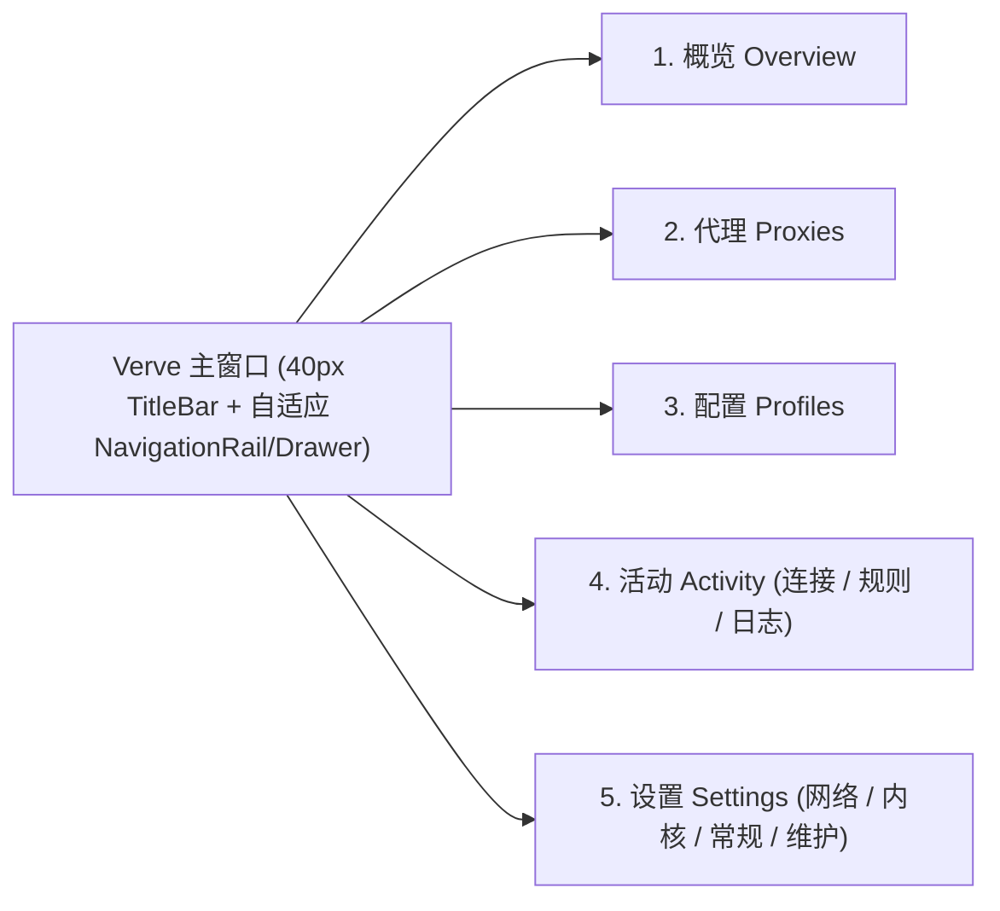

# 产品功能规划与界面设计

[English](design.md) | 中文

本文档完成两项工作：
1. **全量盘点**前期原型界面（复刻自 Clash Verge Rev 的 8 个页面、35+ 弹窗、近百项配置）中的全部功能，明确区分 **P0 刚需核心 / P1 日常高频 / P2 进阶可选 / Drop 历史包袱**；
2. **从零定义** Verve 基于 GPUI + `gpui-material`（Material 3 Expressive）的精简日常产品与界面规格，并严格按[版本与发布](release.zh.md#versioned-roadmap)中的实际版本号顺序推进交付。

## 第一部分：现有界面全量功能盘点与去留决策

分级说明：
- **P0（刚需核心，对应 `0.1.0`）**：代理客户端可独立承担日常上网的最小闭环。
- **P1（日常高频，对应 `0.2.0` – `0.3.0`）**：日常使用明显提升效率的高价值能力。
- **P2（进阶可选，对应 `0.4.0`）**：有明确场景但不占主界面认知负担，收进高级区或后续迭代。
- **Drop（历史包袱）**：源于老 Web 客户端历史堆积、高维护低收益或与原生 GPUI 架构冲突，**明确剔除**。

### 1. 全局壳层与系统集成

| 现有功能 | 决策 | 说明与处理方式 |
| :--- | :---: | :--- |
| 窗口标题栏与侧边导航栏（展开/收起） | **P0** | 保留 `NavigationDrawer` / `NavigationRail` 自适应折叠 |
| 侧边栏底部实时流量微件（速率 + 迷你曲线 + RAM） | **P1** | 保留紧凑实时速率/曲线卡，去掉点击切换“填充/空心”冗余交互 |
| 浅色 / 深色 / 跟随系统主题与动态强调色 | **P0** | 基于 `gpui-material` 动态种子色，支持快速切换 |
| 系统托盘常驻与窗口关闭释放资源 | **P0** | 关闭主窗口即销毁 GPUI 窗口释放 GPU 内存，托盘菜单控制模式/代理/TUN/退出 |
| 单实例保护、开机自启、静默启动 | **P1** | 纳入常规设置与系统启动流 |
| 多语言切换（中文 / English） | **P1** | 基于 `rust-i18n` 统一管理，取消代码中手写 `if zh {} else {}` |
| 全局快捷键（切换代理/TUN/模式/显隐窗口） | **P2** | 精简为 4~5 个核心动作热键，去掉“重新激活配置”等生僻项 |
| 退出二次确认弹窗 | **P2** | 仅托盘/菜单退出可选，常规关闭按钮默认最小化到托盘 |
| 侧边栏图标模式（单色 / 彩色 / 隐藏） | **Drop** | 破坏 M3 视觉一致性，统一使用 M3 标准单色/选中态图标 |
| 通知弹窗四角位置自定义（4 方向） | **Drop** | 统一固定右下角 Snackbar，无须暴露配置 |
| 轻量模式开关 + 空闲倒计时 + 确认弹窗 | **Drop** | **历史包袱**（WebView 吃内存的补丁）；GPUI 窗口关闭天然释放渲染资源 |
| 全局设置搜索弹窗（`SettingsSearch`） | **Drop** | 精简设置项后左栏 4 分类一眼看完，无需维护独立全文检索索引 |
| 托盘自定义三态图标上传 / 内联代理组模式配置 | **Drop** | 过度定制，统一提供清晰的三态内置托盘图标（普通 / 系统代理 / TUN） |
| 强制系统原生标题栏切换 | **Drop** | 跟随各平台原生最佳实践即可，不暴露易出布局错位的开关 |
| 代理页悬停跳转导航器延迟配置 | **Drop** | 细枝末节的历史配置 |

### 2. 首页 / 概览（原 `Home`）

| 现有功能 | 决策 | 说明与处理方式 |
| :--- | :---: | :--- |
| 代理模式切换（Rule / Global / Direct） | **P0** | 概览页核心操作区直接切换 |
| 系统代理 & TUN 开关 + 服务状态指示 | **P0** | 合并为统一“网络接管”控制卡，清晰展示互斥/协同状态 |
| 当前激活配置摘要（名称 / 流量用量 / 到期 / 一键更新 / 快速切换） | **P0** | 合并为精简配置卡，下拉直接切换配置，无需独立“切换配置弹窗” |
| 当前代理组与出口节点快速切换 | **P0** | 概览页一键切换主策略组节点与单次测速 |
| 实时流量曲线与累计上传/下载/内存统计 | **P1** | 精简为统一流量卡（支持 1m/5m 窗口切换即可） |
| 一键复制终端代理环境变量（PowerShell / Bash / Zsh / Fish / CMD） | **P1** | 开发者高频刚需，放在概览快捷操作一键复制 |
| 出口公网 IP 与归属地查询（按需手动刷新） | **P2** | 轻量入口按需查询，去掉定时自动轮询与复杂经纬度字段 |
| 首页 9 张卡片自由显隐定制弹窗（`HomeSettings`） | **Drop** | 精简版概览本身即固定高信息密度布局，无需拼装器 |
| 网站连通性测试卡片（增删改排序 + 自定义 SVG 图标弹窗） | **Drop** | 与节点页测速高度重复且维护成本高 |
| Clash 信息卡片 + 系统信息卡片（独立大卡片） | **Drop** | 精简为底部一行状态摘要（内核版本 / 运行时长），不单独占两张卡片 |
| 静态使用说明弹窗（`ManualInfo`） | **Drop** | 内联简短提示与文档链接替代 |

### 3. 代理节点（原 `Proxies`）

| 现有功能 | 决策 | 说明与处理方式 |
| :--- | :---: | :--- |
| 代理模式顶栏切换（Rule / Global / Direct） | **P0** | 与概览页同步，Direct 模式给出清晰空状态说明 |
| 代理组列表（Selector / URLTest / Fallback）展开折叠与节点选择 | **P0** | 自适应响应式节点卡片网格（自动列数，无需手工调 1~5 列） |
| 节点单点测速 & 整组批量测速 + 延迟分色徽标 | **P0** | 统一延迟与自定义测速 URL |
| 分组内快捷操作：搜索过滤、排序（默认/延迟/名称）、定位当前选中节点 | **P1** | 精简内联工具栏，去掉 `Aa`/`ab`/`.*` 三开关冗余（默认不区分大小写模糊匹配） |
| 节点协议与能力标签（协议类型、UDP） | **P1** | 卡片仅展示核心协议与 UDP 标识，去掉 XUDP/TFO/MPTCP/SMUX 过度噪声 |
| Proxy Providers（代理提供者）查看、健康检查与手动更新 | **P1** | 收纳在侧边抽屉，不再单独弹窗堆叠 |
| 固定节点（清除/重置自动组手动锁定） | **P2** | 策略组头小图标菜单提供 |
| 链式代理可视化编排模式（Chain Mode + 入口/出口连线 + 确认/警告弹窗） | **Drop** | 极小众高复杂度交互，进阶用户可直接通过 Merge / Script 声明 `dialer-proxy` |
| 分组头自定义工具栏居左/居右、分组自定义图标开关、右侧悬浮字母跳转条 | **Drop** | 过度视觉配置项，统一固定清爽布局 |

### 4. 配置与订阅管理（原 `Profiles`）

| 现有功能 | 决策 | 说明与处理方式 |
| :--- | :---: | :--- |
| 顶部 URL 输入框一键导入远程订阅 | **P0** | 粘贴链接直接导入，自动识别流量头与到期时间 |
| 新建本地配置 / 导入本地 YAML 文件 | **P0** | 统一“新建/导入”抽屉，减少表单分支 |
| 配置卡片：选中激活、流量进度条、到期时间、更新时间、单键刷新、删除 | **P0** | 明确状态视觉反馈，删除提供简洁确认 |
| 全部订阅一键更新 + 定时自动更新间隔 | **P1** | 后台调度更新，失败保留旧配置并给出清晰错误提示 |
| 配置元信息编辑（名称、URL、更新间隔、是否走代理更新、自定义 UA/超时） | **P1** | 侧边抽屉内编辑，常用字段展开、高级网络字段默认折叠 |
| 原生代码编辑（原始配置 / 单配置 Merge / 单配置 JS Script / 全局 Merge / 全局 Script） | **P1** | 基于 `verve-editor`（YAML/JS 高亮 + 静态补全 + 编译预检行内诊断） |
| 运行时最终合成配置（`active.yaml`）只读预览 + 外部编辑器打开文件 | **P1** | 便于排查覆写结果 |
| 脚本控制台日志查看（编译输出与报错） | **P1** | 直接内嵌在脚本编辑器底部面板，不单独开全局日志弹窗 |
| 复制订阅链接 / 上下调整顺序 | **P2** | 卡片更多菜单中的轻量操作 |
| 可视化规则编辑器 / 节点编辑器 / 代理组编辑器（3 套巨型表单 + YAML AST 解析） | **Drop** | **最大历史包袱之一**；原生 `verve-editor` + Merge/Script + 连接页一键加规则已完全覆盖且更可靠 |
| 批量勾选模式 + 批量删除弹窗 | **Drop** | 个人用户订阅通常 1~5 个，单卡删除已足够 |
| 订阅分享二维码生成弹窗（`ProfileQr`） | **Drop** | 桌面端低频且容易泄露含 Token 的订阅链接 |

### 5. 连接监控（原 `Connections`）

| 现有功能 | 决策 | 说明与处理方式 |
| :--- | :---: | :--- |
| 实时活跃连接列表（主机、代理链、命中规则、进程、瞬时速率、总流量、耗时） | **P1** | 统一紧凑表格视图，内置虚拟滚动，不再维护“列表/表格双视图” |
| 关键词过滤 + 协议筛选（All / TCP / UDP）+ 列头点击排序 | **P1** | 后台线程排序过滤，UI 零卡顿 |
| 暂停/恢复快照、关闭单条连接、一键断开全部连接 | **P1** | 切节点后手动清连接或排查长连接刚需 |
| 连接详情侧边抽屉（完整链路、源/目标地址、进程路径、Sniff Host） | **P1** | 点击行滑出右侧抽屉，不打断主列表浏览 |
| 右键“从此连接一键添加规则”（域名/进程/IP → 指定策略组） | **P1** | 写入 `verve-compiler` 的 Quick Rules 层，刷新订阅不丢失 |
| 已关闭连接历史标签页 | **P2** | 环形缓冲区保留最近 200 条用于排查瞬断请求 |
| 12 列自由拖拽宽度/排序/显隐配置弹窗（`ConnColumns`） | **Drop** | 预设合理的响应式列宽（窄屏自动隐藏次要列），不维护表格自定义引擎 |

### 6. 规则查看（原 `Rules`）

| 现有功能 | 决策 | 说明与处理方式 |
| :--- | :---: | :--- |
| 规则列表查看（类型、Payload、目标策略）+ 关键词搜索 + 单条复制 | **P1** | 并入「活动」中心 Tab，虚拟列表渲染万级规则零压力 |
| Rule Providers（规则集）列表、单项更新与全部更新 | **P1** | 顶部折叠区或侧边抽屉展示，不再另开弹窗 |

### 7. 运行日志（原 `Logs`）

| 现有功能 | 决策 | 说明与处理方式 |
| :--- | :---: | :--- |
| 实时内核日志流 + 等级筛选（Debug / Info / Warning / Error） | **P1** | 并入「活动」中心 Tab，等宽字体固定呈现 |
| 搜索过滤、暂停/恢复、清空日志、单条复制 | **P1** | 去掉独立“正序/倒序”切换与日志详情弹窗（长行直接复制） |
| 导出日志文本 / 打开日志目录 | **P2** | 一键打开日志目录或导出纯文本，无需 JSONL 格式选择器弹窗 |

### 8. 流媒体解锁检测（原 `Unlock`）

| 现有功能 | 决策 | 说明与处理方式 |
| :--- | :---: | :--- |
| 内置 13 项第三方流媒体/AI 服务解锁爬虫检测、历史记录与详情弹窗 | **Drop** | **高维护历史包袱**：第三方风控接口频繁失效、易误报、偏离代理客户端核心职责 |

### 9. 设置中心（原 `Settings`，36 项入口 + 20+ 弹窗）

| 现有功能 | 决策 | 说明与处理方式 |
| :--- | :---: | :--- |
| **网络与接管**：系统代理 + Bypass 列表 + 代理守卫 | **P0** | 抽屉/内联配置，去掉复杂的 PAC 编辑器与内嵌 PAC HTTP 服务器 |
| **网络与接管**：TUN 模式（Stack / Auto Route / Strict Route / DNS Hijack / MTU / 排除网段） | **P0** | 精简保留高频有效字段，提供一键安全默认值 |
| **网络与接管**：特权服务模式安装 / 卸载 / 状态检查（Linux 含 `setcap` 引导） | **P0** | 清晰的状态卡与单步授权引导 |
| **网络与接管**：混合端口（`mixed-port`）、允许局域网（`allow-lan`）、IPv6 | **P0** | 单一混合端口即可满足 99% 场景，**移除**独立 HTTP/SOCKS/Redir/TProxy 8 项端口矩阵 |
| **内核与覆写**：统一延迟、日志等级、GeoData 更新、运行配置预览、内核重启 | **P1** | 直接放在“内核与覆写”分类中 |
| **内核与覆写**：DNS 覆写（Fake-IP / Redir-Host、默认/代理/直连 Nameserver、Fallback、Hosts + 原始 YAML 切换） | **P1** | 收敛为精简常用项 + “直接编辑 DNS YAML”双模式，**移除** 20+ 零碎输入框堆叠 |
| **内核与覆写**：外部控制（TCP 地址 / Secret / CORS） | **P2** | 默认走安全 Named Pipe / UDS，外部 TCP 控制默认关闭并收在高级折叠区 |
| **数据与维护**：本地加密备份/恢复 + WebDAV 自动/手动备份与历史恢复 | **P1** | 基于 `verve-sync` 的简洁抽屉，仅备份同步域 |
| **数据与维护**：打开配置/日志目录、导出脱敏诊断包、检查更新、恢复默认设置 | **P1** | 实用维护工具保留，合并为一个清晰维护分组 |
| **杂项**：切节点自动断开旧连接、自动日志清理周期、默认测速 URL/超时 | **P1** | 并入对应域（内核/维护），取消“杂项设置”垃圾桶分组 |
| 独立多内核切换（Mihomo / Mihomo Alpha 二进制管理弹窗） | **Drop** | 随应用内置单一稳定 Mihomo 内核，高级用户可在 `local.toml` 指定自定义内核路径 |
| Windows UWP 回环豁免工具入口 | **Drop** | 过时的 Win10 历史工具，TUN 模式已原生解决全部 UWP 应用代理 |
| 流量转发隧道管理（`TunnelsManager`） | **Drop** | 极低频高复杂度网络功能，进阶用户直接用配置 Merge 声明 `tunnels` |
| 网卡接口信息查看弹窗（`NetworkInterfaces`） | **Drop** | 仅诊断需要，直接纳入“导出诊断信息”即可 |
| 8 项主题颜色手工 HEX 覆写 + 自定义全局字体弹窗（`ThemeAdvanced`） | **Drop** | M3 动态色方案已保证对比度与协调性，手工改 8 色极易破坏可读性 |
| 启动自动执行外部脚本（`startup-script`） | **Drop** | 高安全风险且非代理核心职责 |
| 自动后台周期延迟检测（`auto_delay_detection`） | **Drop** | 增加无谓网络噪声与节点风控风险；按需测速 + Mihomo 内置 `url-test` 已足够 |

## 第二部分：精简后的 Verve 产品与界面设计

### 1. 设计理念

- **原生 Material 3（Expressive）**：严格遵循 `gpui-material` 的色阶（`SurfaceContainer*`、`PrimaryContainer`、`OutlineVariant`）、排版层级与圆角规范，不照搬 Web/MUI 卡片阴影和花哨装饰。
- **信息密度优先，消灭弹窗地狱**：
  - 简单开关/选择 → **页面内联修改**，即时生效；
  - 详情查看 / 表单配置 / 代码编辑 → **右侧滑出抽屉（`SideSheet`）**；
  - 破坏性操作（删除配置、重置设置）→ **轻量确认对话框**；
  - **严禁弹窗套弹窗**。
- **零假数据与真实驱动**：页面结构严格贴合 `verve-core` 的 `AppSnapshot` 分域切片，只为真实存在的后端状态提供控件。

### 2. 精简信息架构（8 页 → 5 页）

- **顶部导航项（5 个）**：概览、代理、配置、活动（活跃连接数徽标）、设置。
- **底部常驻微件**：紧凑实时速率（下载/上传）+ 40px 迷你流量曲线 + 内核内存占用（收起为 `NavigationRail` 时仅显示下行速率精简胶囊）。
- **顶栏右侧控件（仅 2 项）**：浅色/深色快速切换、内核状态指示灯（绿/黄/红，悬停显示内核版本与运行模式）。

### 3. 各页面核心规格

1. **概览（Overview，`0.1.0`）**：固定两栏响应式网格（窄屏自动单栏）：
   - *接管与模式主控卡*：代理模式分段按钮（Rule / Global / Direct）、系统代理 & TUN 主开关（标注服务权限状态）、快捷条（复制终端代理命令、重启内核）。
   - *当前配置与快切卡*：当前订阅下拉切换与单键刷新、流量进度条与到期日期、主策略组当前出口节点与延迟。
   - *实时流量卡*：上下行瞬时速率、会话累计流量、平滑 Canvas 流量图（1m / 5m）。
   - *底部状态条*：内核版本、混合端口、运行时间、出口 IP 按需检测（`0.4.0`）。
2. **代理（Proxies，`0.1.0`，Providers 于 `0.2.0`）**：
   - 顶栏：模式分段切换 + 全局搜索 + 全组测速 + Proxy Providers 抽屉入口。
   - 分组折叠区：策略类型徽标、当前节点与延迟、内联排序/定位/测速，以及自适应多列节点网格（节点名、协议 + UDP、彩色延迟）。
3. **配置（Profiles，`0.1.0`，原生编辑器与覆写于 `0.2.0`）**：
   - 顶栏导入条：URL 输入框 + 导入、新建本地配置、全部更新、全局覆写抽屉入口。
   - 简洁配置卡片：单击激活、流量进度与到期日、更新时间、单键刷新与精简更多菜单。
   - 原生 `verve-editor` 抽屉：承载 YAML / Merge / Script / 运行配置预览，底部内嵌编译诊断与脚本控制台面板。
4. **活动（Activity，`0.2.0`）**：
   - 顶部 `SegmentedButton` 切换「连接 / 规则 / 日志」，仅当前激活 Tab 持有对应 `TelemetryLease`。
   - *连接*：虚拟滚动表、协议筛选、搜索排序、暂停、关闭单条/全部、详情抽屉、右键一键加规则。
   - *规则*：虚拟滚动列表、搜索、单条复制、`Rule Providers` 抽屉。
   - *日志*：级别筛选、搜索、暂停、清空、等宽字体流与点击复制。
5. **设置（Settings，`0.1.0` 核心项，`0.3.0` 完整覆盖）**：
   - 左分类导航 + 右分组内联表单（网络与接管 / 内核与覆写 / 常规与外观 / 数据与维护）；DNS 原始 YAML、WebDAV 历史与诊断预览通过 `SideSheet` 展示。

## 第三部分：按版本号驱动的交付计划

Verve 不使用抽象的 Phase 划分阶段，而是直接按实际版本号推进：先完成 `0.0.1`（无头内核闭环）与 `0.0.2`（UI 壳层、系统集成与特权服务），以 **`0.1.0`** 作为首个日常可用版本，再依次演进至 `0.2.0` → `0.3.0` → `0.4.0` → `1.0.0`。完整里程碑、交付范围与验收标准见[版本与发布](release.zh.md#versioned-roadmap)。
